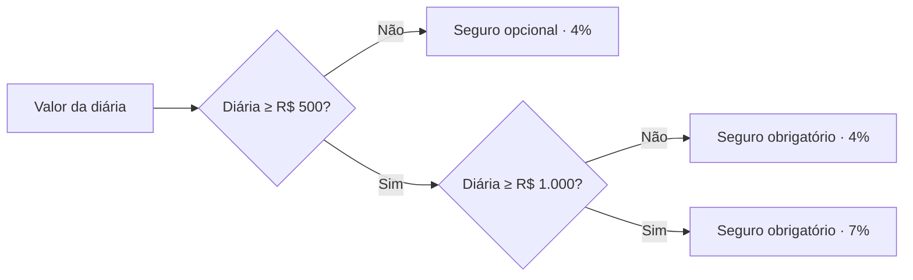
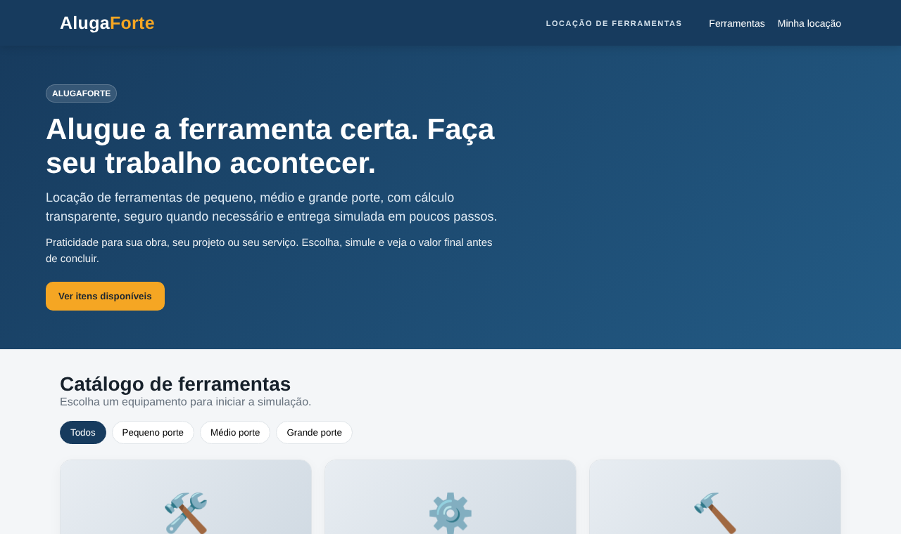
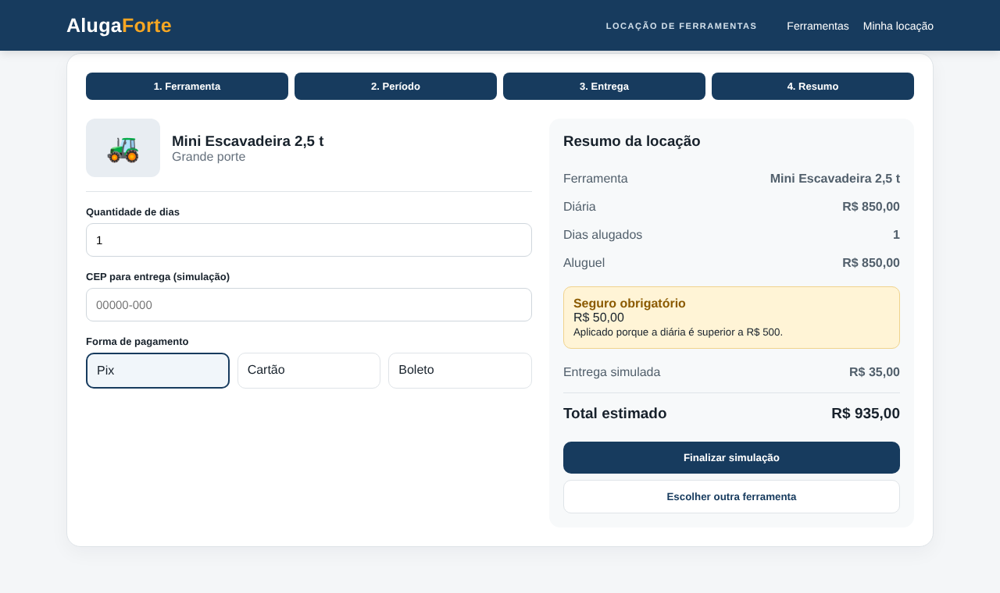
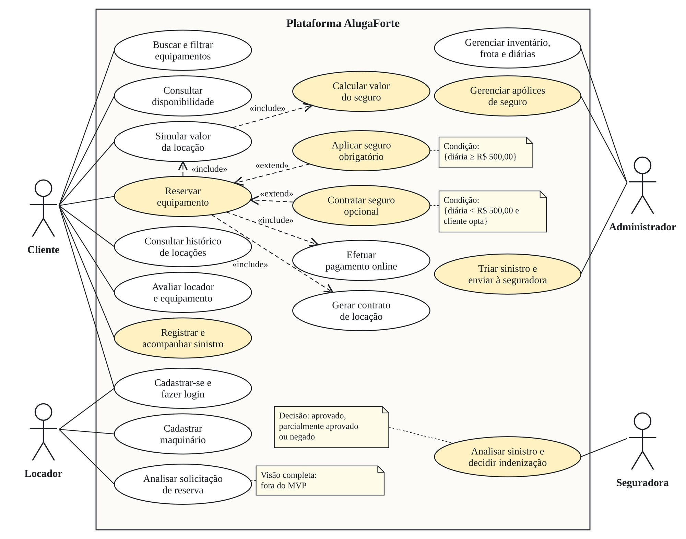
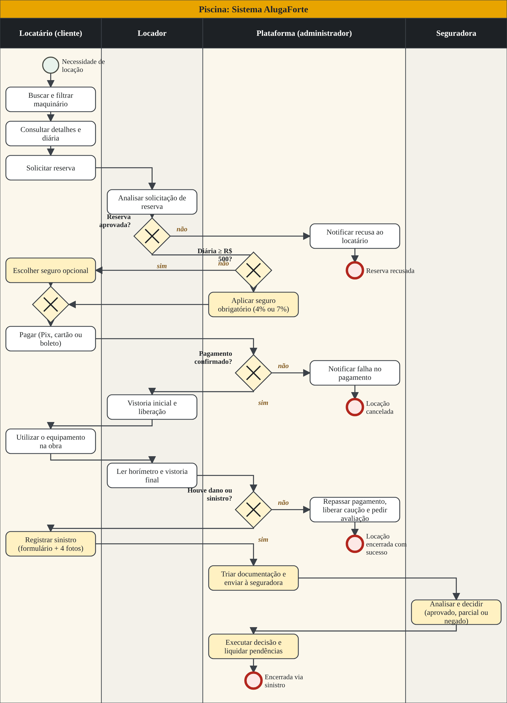

<div align="center">


# AlugaForte

### Locação de maquinários com seguro integrado

**Gestão Ágil** · Projeto com Scrum em 4 sprints · Trabalho em grupo · UNICID 2026

[](https://alugaforte.netlify.app)
[](docs/Documentacao_AlugaForte.pdf)

[](https://github.com/novaishenrique/projeto-AlugaForte/actions/workflows/ci.yml)


</div>

---

## Sumário

- [Sobre o projeto](#sobre-o-projeto)
- [Demonstração](#demonstração)
- [Equipe e organização Scrum](#equipe-e-organização-scrum)
- [Requisitos](#requisitos)
- [Casos de uso](#casos-de-uso)
- [Regras do seguro e calculadora](#regras-do-seguro-e-calculadora)
- [Processo de locação (BPMN)](#processo-de-locação-bpmn)
- [Product Backlog](#product-backlog)
- [Checkout e sinistros](#checkout-e-sinistros)
- [Gestão de riscos](#gestão-de-riscos)
- [Protótipo](#protótipo)
- [Conclusão](#conclusão)
- [Estrutura do repositório](#estrutura-do-repositório)
- [Como executar](#como-executar)
- [Referências](#referências)

---

## Sobre o projeto

A compra de maquinário, como retroescavadeira, betoneira, compactador e guindaste, é cara e frequentemente subutilizada. Por isso, construtoras, produtores rurais e autônomos preferem alugar esses equipamentos. No entanto, o processo de locação costuma ser informal, sem transparência quanto à disponibilidade e com riscos mal distribuídos, como quebra, acidente e roubo.

Diante desse cenário, o **AlugaForte** propõe uma plataforma digital que conecta locadores e locatários de maquinários de pequeno, médio e grande porte, com catálogo, reserva e contrato online. O projeto foi recebido no rodízio de grupos; a equipe analisou o escopo original e propôs a inovação do seguro integrado.

### O problema

- Máquina pesada é cara e fica parada entre uma obra e outra.
- A locação é informal: pouca clareza de preço e disponibilidade.
- Quebra e furto não têm responsável definido.

### A inovação: seguro integrado

A regra de negócio central é definida pelo valor da diária do equipamento:



Essa regra se justifica pelos seguintes motivos:

1. Quanto maior o valor do equipamento, maior o prejuízo em caso de sinistro, e o corte de R$ 500,00 usa a diária como indicador de risco financeiro.
2. O seguro protege o locador (patrimônio), o locatário (que não responde sozinho por danos) e a plataforma (com menos disputas).
3. Para equipamentos de menor valor, a opção mantém a liberdade do cliente e o preço competitivo.
4. O seguro integrado é um diferencial, porque os concorrentes costumam tratar o seguro como um item externo ou inexistente.

### Termos usados

| Termo | Significado |
|---|---|
| **Cliente (ou locatário)** | Quem aluga o equipamento. |
| **Locador (ou locadora)** | Quem é dono do maquinário e o disponibiliza para locação. |
| **Administrador** | Gestor da plataforma, responsável pelo inventário, pelas diárias, pelas apólices e pela triagem dos sinistros. |
| **Seguradora** | Empresa parceira que analisa os sinistros e decide sobre a indenização. |

---

## Demonstração

O protótipo está publicado em **[alugaforte.netlify.app](https://alugaforte.netlify.app)**.

**Fluxo principal:** Ferramenta → Período → Entrega e pagamento → Resumo com seguro

| Catálogo de ferramentas | Simulação com seguro |
|:---:|:---:|
|  |  |

> [!NOTE]
> O AlugaForte é um protótipo acadêmico, sem integração com pagamentos reais: as opções de pagamento e a finalização da locação servem apenas para demonstrar o fluxo proposto.

---

## Equipe e organização Scrum

### Papéis

| Product Owner | Scrum Master | Developers | Stakeholder |
|:---:|:---:|:---:|:---:|
| Kauã Justino da Silva | Mateus Alves dos Santos | Os 10 integrantes | Professor |

> **Product Goal:** alugar maquinário pela internet, com seguro integrado e custo transparente.

### Sprints

| Sprint | Tema | Responsáveis |
|---|---|---|
| **Sprint 1** | Requisitos | Wendel · Mateus Alves |
| **Sprint 2** | Modelagem e seguro | Luiz · Nathan |
| **Sprint 3** | Processo e backlog | Washington · Mateus Moreira |
| **Sprint 4** | Riscos, protótipo e entrega | Diego · Kauã · Rafael · Henrique |

### Integrantes

| # | Nome | RGM | Parte no trabalho |
|:---:|---|---|---|
| 1 | Wendel Andrioli de Melo | 1747411724 | Contexto e inovação |
| 2 | Mateus Alves dos Santos | 47435887 | Requisitos não funcionais · Scrum Master |
| 3 | Luiz Felipe | 49073150 | Casos de uso |
| 4 | Nathan Vieira | 49462725 | Seguro e calculadora |
| 5 | Washington de Souza Silva | 04908015-6 | Backlog e processo |
| 6 | Mateus Moreira | 049827189 | Checkout e sinistros |
| 7 | Diego Pignatari | 47515741 | Riscos e conclusão |
| 8 | Kauã Justino da Silva | 50011944 | Protótipo · Product Owner |
| 9 | Rafael Ribeiro | 1749725611 | Documento e MVP |
| 10 | Henrique Novais de Oliveira | 47046996 | Slides e sinistro |

---

## Requisitos

### Requisitos funcionais

Os requisitos funcionais (RFs) descrevem o que o sistema faz. Os requisitos **RF08, RF09, RF10 e RF13** são os que sustentam a inovação do seguro integrado.

| ID | Requisito |
|---|---|
| **RF01** | Cadastro e login de usuários (locador e locatário). |
| **RF02** | Cadastro de maquinários com porte, descrição, fotos e valor da diária. |
| **RF03** | Classificação por porte (pequeno, médio e grande). |
| **RF04** | Busca e filtros (porte, categoria, preço e disponibilidade). |
| **RF05** | Consulta de disponibilidade por calendário. |
| **RF06** | Reserva ou solicitação de aluguel por período. |
| **RF07** | Cálculo automático do valor total (diárias × período), incluindo o frete/traslado e as horas excedentes registradas no horímetro. |
| **RF08** | Contratação automática do seguro quando a diária for igual ou superior a R$ 500,00. |
| **RF09** | Oferta opcional do seguro quando a diária for inferior a R$ 500,00. |
| **RF10** | Cálculo e exibição do valor do seguro na reserva. |
| **RF11** | Pagamento online. |
| **RF12** | Geração do contrato de locação (com apólice, se houver). |
| **RF13** | Registro e acompanhamento de sinistros. |
| **RF14** | Histórico de locações. |
| **RF15** | Avaliação de locadores e equipamentos. |

### Escopo do MVP

O Produto Mínimo Viável (MVP, do inglês *Minimum Viable Product*) é a menor versão do produto que já entrega o valor principal e permite validar a ideia, conceito apresentado por Ries (2011).

Entram no MVP os requisitos **RF01 a RF13**, com duas simplificações: o pagamento online (RF11) é simulado, sem integração com meios de pagamento reais, e o registro de sinistros (RF13) se limita ao formulário de acionamento com geração de protocolo. Além disso, na reserva do MVP a confirmação não depende da aprovação do locador.

Ficam para versões futuras os requisitos **RF14 e RF15**, a integração com meios de pagamento reais e a etapa de aprovação da reserva pelo locador.

| Já no protótipo | Falta para o MVP | Depois do MVP |
|---|---|---|
| Catálogo por porte | Cadastro e login | Área do locador |
| Simulação com seguro e frete | Contrato com apólice | Painel da seguradora |
| Pagamento simulado | Sinistro com protocolo | Histórico e avaliações |
| | Painel do administrador | Pagamento real |

> **Hipótese do MVP:** o seguro integrado aumenta a confiança no aluguel online.

A priorização se justifica pelos seguintes fundamentos:

- ***Lean Startup*:** o MVP serve para aprender com o mínimo de esforço, e a hipótese a validar é se o seguro integrado aumenta a confiança e a adesão ao aluguel (RIES, 2011).
- **Priorização MoSCoW:** são *Must have* os recursos sem os quais não há aluguel nem seguro (cadastro, catálogo, reserva e regra do seguro), enquanto os *Should have* e *Could have* (por exemplo, o painel da seguradora e as avaliações) agregam valor, mas não bloqueiam o valor central.
- **Engenharia de software:** a entrega incremental reduz risco e custo e permite o *feedback* antecipado (SOMMERVILLE, 2011; PRESSMAN; MAXIM, 2016).

### Requisitos não funcionais

| Meta | O que significa |
|:---:|---|
| **2 s** | Tempo máximo para a simulação responder |
| **99,5%** | Disponibilidade por mês |
| **LGPD** | HTTPS e dados criptografados |
| **Libras** | Acessibilidade com VLibras |

- **RNF01 – Usabilidade e design responsivo:** a interface do sistema deve ser intuitiva, moderna e adaptável a diferentes resoluções de tela (smartphones, tablets e computadores), garantindo navegação fluida tanto no canteiro de obras quanto em ambiente de escritório.
- **RNF02 – Desempenho e tempo de resposta:** o cálculo da simulação de locação, incluindo a aplicação da taxa de frete e da regra do seguro obrigatório ou opcional, não deve ultrapassar o tempo de resposta de 2,0 segundos sob condições normais de tráfego.
- **RNF03 – Segurança e privacidade de dados:** a plataforma deve seguir as diretrizes da Lei Geral de Proteção de Dados (LGPD – Lei nº 13.709/2018) (BRASIL, 2018), garantindo criptografia nas informações cadastrais, nas simulações e nas transações financeiras simuladas.
- **RNF04 – Disponibilidade operacional:** o sistema deve manter um nível de serviço com alta taxa de operação (meta de *Service Level Agreement* – SLA – de 99,5%), garantindo que o catálogo de locação e as simulações fiquem acessíveis de forma ininterrupta.
- **RNF05 – Compatibilidade e portabilidade:** o sistema deve ser acessível por navegadores web modernos (Google Chrome, Samsung Browser, Safari e Microsoft Edge), sem necessidade de instalação de dependências ou *plugins* adicionais.
- **RNF06 – Acessibilidade digital (VLibras):** o sistema deve oferecer recursos de acessibilidade para pessoas com deficiência auditiva, integrando o *widget* do VLibras (Língua Brasileira de Sinais) para tradução em tempo real dos conteúdos textuais da plataforma, em conformidade com as diretrizes de acessibilidade web.

### Arquitetura operacional

**Modelo de execução: 100% hospedado na nuvem.** Essa escolha garante que a aplicação não dependa da capacidade de processamento dos dispositivos dos clientes ou dos administradores.

- **Execução online:** todo o motor de cálculo, a exibição do catálogo e o registro de seguros e sinistros rodam em tempo real na nuvem, o que permite atualizações instantâneas de preços e de disponibilidade de equipamentos para todos os usuários.
- **Conectividade:** por se tratar de um sistema web integrado com cálculo dinâmico de seguro e frete, a plataforma exige conexão ativa com a internet para a conclusão de simulações e do checkout.

**Perfis de acesso**

| Perfil | Acesso |
|---|---|
| **Cliente (público)** | Navegação no catálogo, filtragem de equipamentos por porte (pequeno, médio e grande), simulações dinâmicas de preços e frete, aceite das cláusulas de seguro e acionamento do canal de sinistros e suporte. |
| **Administrador (restrito)** | Painel interno para atualização de inventário, alteração de valores de diárias, gerenciamento das apólices ativas de seguro, controle de frota e análise de chamados de sinistro abertos. |

Na visão completa da plataforma, o locador também acessa uma área restrita, para cadastrar seus equipamentos e analisar as solicitações de reserva. No MVP, essas funções de gestão do maquinário ficam concentradas no perfil administrador.

**Escalabilidade:** a arquitetura foi projetada de forma modular para permitir escalabilidade horizontal e vertical.

- A separação clara entre a interface do usuário (*front-end*) e a lógica de processamento de regras (*back-end*) permite absorver picos de tráfego, como a alta demanda de locação em períodos comerciais de pico, sem degradação do desempenho.
- O modelo em nuvem permite a alocação automática de recursos de servidor conforme aumenta a demanda de acessos simultâneos.

**Disponibilidade e manutenção:**

- **Janelas de manutenção programada:** atualizações do sistema ou inclusão de novos recursos serão realizadas fora do horário comercial habitual, preferencialmente entre 23h e 5h.
- **Redundância:** utilização de infraestrutura com replicação de dados para que, em caso de falha de um servidor, a aplicação permaneça ativa sem perda de dados das simulações ou dos registros efetuados.

---

## Casos de uso

O diagrama de casos de uso da *Unified Modeling Language* (UML) mapeia as interações entre os atores **Cliente, Locador, Administrador e Seguradora** e as funcionalidades da plataforma. Ele representa a visão completa da plataforma; o escopo do MVP está definido em [Escopo do MVP](#escopo-do-mvp).

<p align="center">
  
</p>

- **«include»:** reservar sempre inclui simular, pagar e gerar contrato.
- **«extend»:** o seguro obrigatório ou opcional depende da diária.

<details>
<summary><b>Especificação dos principais casos de uso</b></summary>

<br>

| Caso de uso | Ator | Ação do usuário | Resposta do sistema |
|---|---|---|---|
| **Buscar e filtrar equipamentos** | Cliente | Acessa o catálogo e seleciona filtros, como categoria, porte e faixa de preço. | Exibe apenas os equipamentos correspondentes, com o valor da diária e a disponibilidade. |
| **Simular valor da locação** | Cliente | Escolhe o equipamento, informa o período de locação e o CEP de entrega. | Calcula as diárias, o frete e o seguro conforme a regra do valor da diária e apresenta o total estimado. |
| **Reservar equipamento com seguro obrigatório** | Cliente | Confirma a reserva de um equipamento com diária a partir de R$ 500,00. | Insere o seguro (4% ou 7%, conforme a faixa da diária) sem opção de remoção, apresenta o resumo financeiro, registra o pagamento e gera o contrato de locação. |
| **Reservar equipamento com seguro opcional** | Cliente | Confirma a reserva de um equipamento com diária inferior a R$ 500,00 e marca ou não a opção de seguro. | Exibe a caixa de seleção do seguro, recalcula o total conforme a escolha, registra o pagamento e gera o contrato de locação. |
| **Registrar e acompanhar sinistro** | Cliente | Aciona o módulo de sinistros, preenche o formulário e anexa as quatro fotos obrigatórias. | Registra o chamado, gera o número de protocolo e informa a situação do atendimento ao cliente. |
| **Triar sinistro e enviar à seguradora** | Administrador | Analisa o chamado e confere o formulário e as fotos anexadas. | Atualiza a situação do chamado e encaminha a documentação à seguradora. |
| **Analisar sinistro e decidir indenização** | Seguradora | Analisa a documentação e decide: aprovado, parcialmente aprovado ou negado. | Registra a decisão e notifica o cliente, com a liberação da indenização ou de máquina reserva, quando aprovada. |

</details>

---

## Regras do seguro e calculadora

A lógica de cálculo varia conforme o valor da diária da máquina. Para equipamentos com diária a partir de R$ 500,00, o seguro é obrigatório e cobre a **Responsabilidade Civil Facultativa (RCF)** e os **Riscos Diversos (RD)**, estes últimos contra tombamento, furto e incêndio. Há franquia por sinistro.

| Diária | Seguro | Alíquota |
|---|---|:---:|
| Abaixo de R$ 500,00 | Opcional | 4% |
| De R$ 500,00 a R$ 999,99 | Obrigatório | 4% |
| A partir de R$ 1.000,00 | Obrigatório | 7% |

A alíquota é definida pela faixa da diária, e não pela classificação de porte, porque a diária é o indicador mais direto do valor do equipamento e do prejuízo em caso de sinistro. Assim, um equipamento de médio porte com diária de R$ 800,00 continua com a alíquota de 4%, enquanto os 7% alcançam os equipamentos de maior valor de mercado, como escavadeiras hidráulicas e guindastes, que normalmente superam R$ 1.000,00 por dia. O limite de R$ 1.000,00 é uma referência inicial e pode ser ajustado com a seguradora parceira.

Para máquinas com diária inferior a R$ 500,00, o cliente pode escolher não contratar o seguro. Ele pode contratá-lo para evitar burocracia e transtornos caso ocorra algo que não estava programado e seja necessária uma máquina reserva para concluir o serviço.

O traslado pode ser ajustado à parte com o cliente, caso ele opte por realizar o transporte por conta própria.

### Fórmulas do cálculo

| Equação | Fórmula |
|:---:|---|
| (1) | *S* = *V*<sub>base</sub> × taxa |
| (2) | *D* = *V*<sub>base</sub> + *S* |
| (3) | *H*<sub>base</sub> = *D* ÷ 8 h |
| (4) | *V*<sub>exc</sub> = (*H*<sub>reg</sub> − 8 h) × *H*<sub>base</sub> |
| (5) | *V*<sub>dia</sub> = *D* + *V*<sub>exc</sub> + *F* |

Onde:

- *V*<sub>base</sub>: valor base da diária do equipamento;
- taxa: alíquota do seguro, de 4% (diária de R$ 500,00 a R$ 999,99 ou seguro opcional contratado) ou 7% (diária a partir de R$ 1.000,00);
- *S*: valor do seguro, igual a zero quando o seguro opcional não é contratado;
- *D*: diária com seguro;
- *H*<sub>base</sub>: valor da hora base;
- *H*<sub>reg</sub>: horas registradas no horímetro no dia;
- *V*<sub>exc</sub>: valor das horas excedentes, igual a zero quando *H*<sub>reg</sub> não ultrapassa 8 h;
- *F*: frete/traslado, quando houver;
- *V*<sub>dia</sub>: valor total do dia.

> **Total da locação** = aluguel + seguro + frete + horas extras − cupom · caução à parte

### Exemplo prático: mini escavadeira

Diária de R$ 500,00, com seguro obrigatório de 4%, correspondente a 8 horas de trabalho por dia. Considerando 10 horas registradas no horímetro:

| Etapa | Cálculo | Resultado |
|---|---|---:|
| Diária com seguro | R$ 500,00 + (R$ 500,00 × 4%) | R$ 520,00 |
| Hora base | R$ 520,00 ÷ 8 h | R$ 65,00/h |
| Horas excedentes | 10 h − 8 h | 2 h |
| Valor das horas excedentes | 2 × R$ 65,00 | R$ 130,00 |
| **Valor final do dia** | R$ 520,00 + R$ 130,00 | **R$ 650,00** |

---

## Processo de locação (BPMN)

O processo de locação, da busca pela ferramenta ao encerramento ou ao sinistro, foi modelado em *Business Process Model and Notation* (BPMN). Ele representa a visão completa da plataforma e está organizado em uma piscina (Sistema AlugaForte) com quatro raias: **locatário** (cliente), **plataforma** (sistema), **locador** (dono do maquinário) e **seguradora**.

| Etapa | Quem | O que acontece | Decisão |
|:---:|---|---|---|
| 1 | Locatário | Busca e pede a reserva | Locador aprova? |
| 2 | Plataforma | Aplica a regra do seguro | Diária ≥ R$ 500? |
| 3 | Locatário | Paga a locação | Pagamento confirmado? |
| 4 | Locador | Vistoria, uso e devolução | Houve sinistro? |

Se a reserva for recusada ou o pagamento não for confirmado, o processo termina ali.

<p align="center">
  
</p>

<details>
<summary><b>Fluxo completo, passo a passo</b></summary>

<br>

1. **Início (raia do locatário):** necessidade de locação de maquinário detectada.
2. **Busca (locatário):** buscar e filtrar o maquinário por categoria e porte.
3. **Consulta (locatário):** visualizar os detalhes técnicos e o valor da diária.
4. **Solicitação (locatário):** solicitar a reserva do equipamento.
5. **Análise (locador):** analisar a solicitação de reserva do maquinário.
6. **Decisão sobre a reserva:** a reserva foi aprovada pelo locador?
   - Não: a plataforma notifica o cancelamento ao locatário, e o processo termina com o evento "reserva recusada".
   - Sim: o fluxo segue para a regra do seguro.
7. **Regra de negócio (plataforma):** o valor base da diária é igual ou superior a R$ 500,00?
   - Sim: a plataforma aplica a taxa obrigatória de seguro (4% para diárias até R$ 999,99 ou 7% a partir de R$ 1.000,00), e o fluxo avança para o pagamento.
   - Não: o locatário escolhe a inclusão voluntária do seguro opcional.
8. **Pagamento (locatário):** efetuar o pagamento por Pix, cartão ou boleto.
9. **Confirmação do pagamento:** o pagamento foi confirmado?
   - Não: a plataforma notifica a falha na transação, e o processo termina com o evento "locação cancelada por falha financeira".
   - Sim: o fluxo segue para a vistoria inicial.
10. **Vistoria inicial (locatário e locador):** realizar a vistoria inicial física e liberar o maquinário.
11. **Utilização (locatário):** utilizar o equipamento no canteiro de obras durante o período contratado.
12. **Devolução (locatário e locador):** realizar a leitura do horímetro e efetuar a vistoria final na devolução.
13. **Desfecho (plataforma):** houve dano, avaria ou sinistro no período?
    - Não: a plataforma repassa o pagamento ao locador e libera a caução, o locatário realiza a avaliação mútua, e o processo termina com o evento "locação encerrada com sucesso".
    - Sim: o fluxo segue para o tratamento do sinistro.
14. **Registro do sinistro (locatário):** registrar a ocorrência no módulo de sinistros, com envio de formulário e quatro fotos obrigatórias.
15. **Triagem (seguradora):** analisar a documentação e realizar a triagem técnica do sinistro.
16. **Decisão (seguradora):** liberar a indenização ou autorizar o envio de máquina reserva para a obra.
17. **Encerramento (plataforma):** liquidar as pendências financeiras residuais do sinistro, e o processo termina com o evento "locação encerrada via processamento de sinistro".

</details>

---

## Product Backlog

O *Product Backlog* foi estruturado em histórias de usuário (*user stories*), organizadas por épico, com critérios de aceitação no formato **Dado, Quando e Então**, prioridade segundo o método **MoSCoW** e indicação do pertencimento ao escopo do MVP.

| Must | Should | Could | No MVP |
|:---:|:---:|:---:|:---:|
| **9** | **4** | **1** | **10** |

| ID | Épico | História de usuário | Critérios de aceitação | Prioridade | MVP |
|---|---|---|---|:---:|:---:|
| **US01** | Busca | Como locatário, quero filtrar maquinários por porte e preço, para encontrar o equipamento ideal para o meu canteiro de obras. | **Dado** que estou no catálogo; **Quando** seleciono o porte "Grande"; **Então** o sistema exibe apenas equipamentos desse porte em até 2 segundos. | Must | ✅ |
| **US02** | Seguro | Como locatário, quero que o seguro seja obrigatório em diárias ≥ R$ 500, para garantir a proteção patrimonial do bem de alto valor. | **Dado** que escolhi um item com diária de R$ 600; **Quando** avanço para o resumo; **Então** o seguro de 4% é inserido sem opção de remoção. | Must | ✅ |
| **US03** | Seguro | Como locatário, quero ter a opção de contratar seguro em diárias < R$ 500, para mitigar riscos operacionais de pequenas ferramentas. | **Dado** que a diária é de R$ 300; **Quando** visualizo o checkout; **Então** uma caixa de seleção opcional para a proteção deve ser exibida. | Must | ✅ |
| **US04** | Sinistro | Como locatário, quero registrar um sinistro anexando relatórios e mídias, para acionar a cobertura da seguradora em caso de avaria. | **Dado** que o formulário exige evidências; **Quando** anexo menos de 4 fotos; **Então** o sistema bloqueia o envio e exibe um alerta de validação. | Must | ✅ |
| **US05** | Sinistro | Como administrador, quero que um protocolo exclusivo seja gerado no sinistro, para rastrear o chamado junto à seguradora parceira. | **Dado** que o cliente enviou o formulário válido; **Quando** o sistema processa a requisição; **Então** um código único (ex.: PRT-2026-XXXX) é gerado na tela. | Should | ✅ |
| **US06** | Medição | Como administrador, quero calcular as horas excedentes de uso registradas no horímetro, para faturar o uso adicional acima de 8 h/dia. | **Dado** que a máquina operou por 10 h; **Quando** registro a leitura de devolução; **Então** o sistema cobra 2 horas extras proporcionais à hora base. | Must | ✅ |
| **US07** | Cadastro | Como locatário, quero me cadastrar informando CPF ou CNPJ e anexando documento com foto, para validar minha identidade para locações. | **Dado** que sou um novo usuário; **Quando** submeto o formulário de cadastro; **Então** o sistema realiza a validação de formato dos campos obrigatórios. | Must | ✅ |
| **US08** | Anúncio | Como locador, quero cadastrar meus maquinários informando valor da diária, porte e número de série, para disponibilizá-los para locação. | **Dado** que estou no painel restrito; **Quando** preencho os dados técnicos do equipamento; **Então** o item fica salvo no banco de dados como pendente de aprovação. | Must | ✅ |
| **US09** | Reserva | Como locador, quero ser notificado sobre novas solicitações de reserva, para que eu possa aprovar ou recusar o pedido de locação. | **Dado** que um cliente solicitou uma máquina; **Quando** a reserva entra no sistema; **Então** recebo um alerta com a data inicial, a data final e o CEP de destino. | Must | ❌ |
| **US10** | Pagamento | Como locatário, quero efetuar o pagamento via Pix com QR Code dinâmico, para obter a aprovação instantânea da reserva da máquina. | **Dado** que selecionei a opção Pix; **Quando** clico em finalizar; **Então** o sistema gera um código Copia e Cola válido por cerca de 30 minutos. | Must | ✅ |
| **US11** | Pagamento | Como locatário, quero parcelar o pagamento no cartão de crédito e pré-autorizar a caução, para preservar o fluxo de caixa da minha empresa. | **Dado** que escolhi pagamento via cartão; **Quando** insiro os dados; **Então** o sistema processa o valor do aluguel e retém o valor da caução de forma separada. | Should | ✅ |
| **US12** | Vistoria | Como locador, quero registrar fotos de vistoria digital no momento da entrega do bem, para comprovar o estado inicial de conservação do item. | **Dado** que o transporte foi confirmado; **Quando** realizo a entrega física; **Então** anexo o laudo de conferência visual assinado no aplicativo da plataforma. | Should | ❌ |
| **US13** | Avaliação | Como locatário, quero avaliar o estado do maquinário e o atendimento do locador, para dar *feedback* de qualidade para a comunidade. | **Dado** que a locação foi encerrada e finalizada; **Quando** acesso o histórico; **Então** posso atribuir uma nota de 1 a 5 estrelas e redigir um comentário. | Could | ❌ |
| **US14** | Painel | Como analista da seguradora, quero acessar um painel integrado de sinistros em triagem, para deferir ou indeferir o pagamento de indenizações. | **Dado** que existem chamados sob análise; **Quando** abro o painel técnico; **Então** visualizo o laudo comparativo e as evidências fotográficas enviadas pelo cliente. | Should | ❌ |

---

## Checkout e sinistros

### Fluxo de checkout

O checkout tem **seis etapas**: carrinho → identificação (pessoa física ou jurídica) → entrega ou retirada → proteção e termos → pagamento → confirmação.

| Dados coletados | Itens |
|---|---|
| **Cliente** | CPF/CNPJ, contato e documento com foto |
| **Entrega ou retirada** | Modalidade, endereço e horários |
| **Locação** | Itens, período, proteção, cupom e aceite dos termos |

O estoque fica reservado por tempo limitado, e o pedido só é confirmado depois que o pagamento é aprovado.

### Formas de pagamento

| Forma | Como funciona |
|---|---|
| **Pix** | *QR Code* e *copia e cola*, validade de cerca de 30 minutos e confirmação automática. |
| **Cartão** | Validação dos dados, parcelamento, sem armazenamento do código de verificação (CVV) e possibilidade de pré-autorizar a caução. |
| **Boleto** | Vencimento em 1 a 3 dias úteis, compensação em até 2 dias úteis e cancelamento do pedido se vencer. |

No Pix e no boleto, a caução é paga e depois devolvida.

### Comprovante e resumo financeiro

O comprovante traz o cabeçalho do pedido, os dados do cliente, os dados da locação, a forma de pagamento e um rodapé com políticas e suporte. O resumo financeiro lista subtotal, desconto, frete, proteção, caução reembolsável e total a pagar. Ele aparece na tela, é enviado por e-mail e fica disponível em PDF na área do cliente.

### Módulo de sinistros e suporte

1. **Acionamento:** pelo botão na área do cliente, por WhatsApp ou por telefone, em até 24 horas; em caso de furto ou roubo, o acionamento deve ser imediato e acompanhado do boletim de ocorrência.
2. **Dados exigidos:** pedido, equipamento, tipo de ocorrência, data, hora e local, descrição, operador, testemunhas e contato.
3. **Evidências:** mínimo de quatro fotos, com o número de série visível, vídeo curto recomendado e comparação com as fotos de saída.
4. **Fluxo de análise:** abertura → triagem pelo administrador → envio à seguradora → análise → decisão (aprovado, parcialmente aprovado ou negado) → execução → encerramento.
5. **Prazos de referência:** resposta inicial em até 1 dia útil e liberação da caução em até 5 dias úteis após o encerramento.

> [!NOTE]
> Os valores e os prazos desta seção são exemplos, até a confirmação com a operação. No protótipo, os pagamentos são simulados.

---

## Gestão de riscos

### Os quatro riscos de nível alto

| Risco | Como reduzimos |
|---|---|
| Internet fraca no canteiro de obras | Site leve, que carrega em 3G/4G |
| Atraso da seguradora | Prazo de 1 dia útil em contrato e alertas |
| Falha no atendimento do sinistro | Três canais e protocolo único |
| Atraso entre os integrantes | Prazos internos e Daily Scrum |

*Nível = probabilidade × impacto.*

### Matriz de riscos

| Risco identificado | Probabilidade | Impacto | Mitigação / contingência |
|---|:---:|:---:|---|
| **Instabilidade de conectividade no canteiro de obras** | Alta | Médio | Interface responsiva, leve e otimizada para carregamento rápido, mesmo sob redes móveis de baixa velocidade (3G/4G). |
| **Divergência na leitura do horímetro na devolução da máquina** | Média | Médio | Exigência de registro fotográfico do horímetro na entrega e no recolhimento da máquina, com anexo direto no contrato digital. |
| **Atraso na validação de sinistros pela seguradora parceira** | Média | Alto | Definição contratual de SLA de resposta inicial em até 1 dia útil e emissão de alertas automáticos no painel do administrador. |
| **Recusa do cliente em pagar o seguro em diárias ≥ R$ 500,00** | Média | Baixo | Mensagem informativa e transparente na calculadora, justificando a obrigatoriedade pela cobertura de frotas (RCF e RD) para bens de alto valor. |
| **Incoerência nos cálculos de frete/traslado por CEPs distantes** | Baixa | Médio | Mapeamento de tabelas de frete regionalizadas e flexibilidade para o cliente optar pelo traslado por conta própria. |

---

## Protótipo

O site foi desenvolvido com **HTML, CSS e JavaScript**. Essas tecnologias permitem estruturar a página, desenvolver o visual e implementar funcionalidades como o catálogo de equipamentos, a simulação do aluguel, o cálculo do frete e a aplicação da regra do seguro.

Para disponibilizar o projeto na internet, utilizou-se a plataforma **Netlify**, no endereço [alugaforte.netlify.app](https://alugaforte.netlify.app). Optou-se pela hospedagem gratuita porque o projeto é um protótipo acadêmico e não necessita, neste momento, de uma infraestrutura paga. Essa opção permite publicar o site de forma simples, testar suas funcionalidades e compartilhar o acesso com professores e colegas, sem custos de hospedagem. Quanto ao domínio, o projeto utiliza o subdomínio gratuito fornecido pelo Netlify, sem necessidade de registrar um domínio próprio, como .com ou .com.br.

Também se utilizou inteligência artificial como apoio na criação do código e da interface, por meio de comandos chamados *prompts*. Esse recurso auxiliou na organização dos elementos visuais e na implementação das funcionalidades.

Uma das principais dificuldades foi organizar as funcionalidades e fazer os cálculos funcionarem corretamente, em especial a soma do valor das diárias, o cálculo do frete e a aplicação do seguro obrigatório para equipamentos com diária a partir de R$ 500,00.

O resultado do desenvolvimento é demonstrado com o site em funcionamento, percorrendo a página inicial, o catálogo de equipamentos e a simulação de locação.

> [!IMPORTANT]
> **Diferença entre o protótipo e a regra documentada:** o site publicado ainda cobra um seguro fixo de R$ 50,00 por locação quando a diária passa de R$ 500,00 e não oferece o seguro opcional. A regra da documentação (4% sobre o aluguel de R$ 500,00 a R$ 999,99, 7% a partir de R$ 1.000,00 e seguro opcional abaixo de R$ 500,00) é a que vale para o MVP e entra na próxima versão do site.

---

## Conclusão

O projeto AlugaForte teve como propósito facilitar a locação de maquinários para obras, oferecendo mais segurança e praticidade a clientes e locadores. A partir da análise do escopo recebido, a equipe propôs como diferencial o seguro integrado à reserva, cuja regra é definida pelo valor da diária: obrigatório para diárias a partir de R$ 500,00, com taxa de 4% até R$ 999,99 e de 7% a partir de R$ 1.000,00, e opcional abaixo desse valor. Essa inovação protege o patrimônio do locador e reduz o risco financeiro do cliente durante o período de uso do equipamento.

Ao longo do trabalho, a ideia foi transformada em especificações verificáveis: os requisitos funcionais e não funcionais, a modelagem e as regras de negócio do seguro e da calculadora, o processo de locação em BPMN e o Product Backlog com 14 histórias de usuário priorizadas, além da matriz de riscos do projeto. A adoção do Produto Mínimo Viável, com apoio da priorização MoSCoW, permitiu concentrar a primeira entrega no que gera valor imediato (catálogo, simulação de aluguel, contratação do seguro, checkout e abertura de sinistro), deixando para etapas futuras a aprovação pelo locador, os pagamentos reais, o histórico de locações e a avaliação de locadores e equipamentos.

O protótipo publicado na internet demonstra a viabilidade da proposta, embora, por ser acadêmico, simule o pagamento e não substitua uma operação comercial. Conclui-se que a aplicação de práticas ágeis (backlog, histórias de usuário, priorização e entrega incremental) contribuiu para organizar o escopo, alinhar a equipe e reduzir riscos, atingindo o objetivo de especificar e prototipar uma plataforma de locação com seguro integrado.

> **O seguro virou parte da locação, com regra clara pela diária.**
> Sucesso = mais confiança e menos disputas, não só velocidade.

### Próximos passos

- [ ] Completar o MVP
- [ ] Área do locador
- [ ] Pagamento real
- [ ] Testar com construtoras
- [ ] Integrar a análise de sinistros com seguradoras

---

## Estrutura do repositório

```
.
├── site/
│   └── index.html                 ← o protótipo (HTML, CSS e JavaScript em um arquivo)
├── docs/
│   └── Documentacao_AlugaForte.pdf  ← documentação técnica e acadêmica (ABNT)
├── imagens/                       ← diagramas UML e BPMN e telas do site usados neste README
├── .github/
│   ├── capa.jpg                   ← capa deste README
│   ├── tests/repo.test.js         ← testes automáticos
│   └── workflows/ci.yml           ← roda os testes a cada push
└── README.md
```

O `site/index.html` é o mesmo arquivo publicado no Netlify.

---

## Como executar

O site não precisa de instalação nem de servidor:

1. Baixe o repositório (**Code → Download ZIP**) ou clone com `git clone https://github.com/novaishenrique/projeto-AlugaForte.git`.
2. Abra `site/index.html` no navegador.

**Testes automáticos** (Node 20 ou mais novo):

```bash
node --test .github/tests/*.test.js
```

Eles conferem os links e imagens do README, a sintaxe do JavaScript, se todo botão chama uma função que existe e se o catálogo tem os três portes.

---

## Referências

- BRASIL. Lei nº 13.709, de 14 de agosto de 2018. Lei Geral de Proteção de Dados Pessoais (LGPD). Brasília, DF: Presidência da República, 2018.
- **PLATAFORMA ALUGAFORTE**: protótipo funcional. [S. l.]: Netlify, 2026. Disponível em: https://alugaforte.netlify.app/. Acesso em: 12 out. 2026.
- PRESSMAN, Roger S.; MAXIM, Bruce R. **Engenharia de software**: uma abordagem profissional. 8. ed. Porto Alegre: AMGH, 2016.
- RIES, Eric. **The lean startup**: how today's entrepreneurs use continuous innovation to create radically successful businesses. New York: Crown Business, 2011.
- SOMMERVILLE, Ian. **Engenharia de software**. 9. ed. São Paulo: Pearson Prentice Hall, 2011.

---

<div align="center">

<sub>AlugaForte · Gestão Ágil · Gestão da Tecnologia da Informação · UNICID 2026</sub>

</div>
